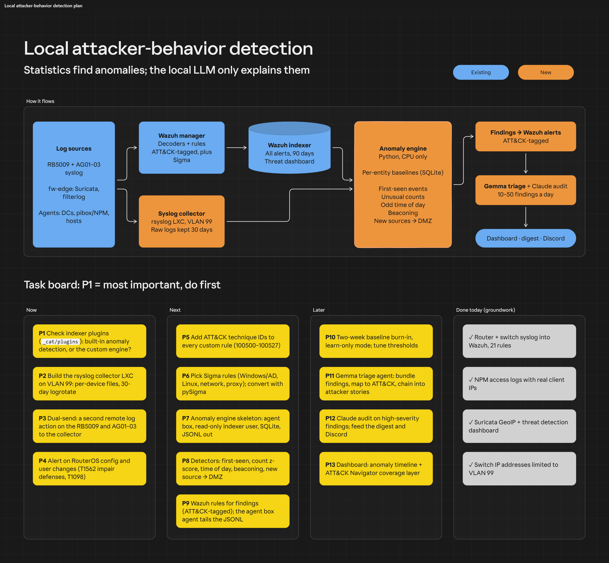

# homelab-siem

Log collection and detection for a home lab built around Wazuh: a dedicated rsyslog collector on the management VLAN, dual-sent syslog from a MikroTik RB5009 and three CRS305 switches, Suricata EVE from the OPNsense edge firewall, Nginx Proxy Manager access logs with real client IPs, and custom ATT&CK-tagged Wazuh decoders and rules (including RouterOS config- and user-change detection).

Companion repos: [attack-stories](https://github.com/tyorek/attack-stories) (chains alerts into ATT&CK attacker stories + drill-down dashboard), [anomaly-engine](https://github.com/tyorek/anomaly-engine) (statistical baselines → ATT&CK-tagged findings), [sigma2wazuh](https://github.com/tyorek/sigma2wazuh) (Sigma → Wazuh rule converter).

| Folder | What it is |
|---|---|
| `collector/` | the collector container's config: rsyslog per-device files and stream map, logrotate (30 days), nftables, nfcapd flow capture, freshness check |
| `dns-syslog-forwarding/` | DNS server syslog forwarding + Technitium log exporter config |
| `fw-edge-eve-forwarder/` | OPNsense Suricata EVE → Wazuh agent block |
| `mikrotik/` | RouterOS scripts: dual-send logging, config-change logging, DNS round-robin for the collector |
| `wazuh/` | custom decoders and rules (MikroTik, NPM, config changes), NPM agent config |
| `docs/` | build record, collector stand-up runbook, read-only indexer user setup, the Wazuh/syslog rollout, the detection plan diagram and the threat-detection dashboard |

---

*Published from a home lab. Site identifiers are sanitized: public IPv4 uses the documentation ranges (203.0.113.0/24, 198.51.100.0/24), the delegated IPv6 prefix is `2001:db8::/32`, the ULA prefix is `fd12:3456:789a::/48`, domains are `example.com` / `home.arpa`, MAC addresses, Wi-Fi SSIDs, serials, keys and names are replaced. RFC 1918 addresses are left as they are so the layouts still read. Credentials are never in these files; scripts read them from `agent.env` or similar files that are not published.*

## Disclaimer

This repository is shared **as is**, for reference and learning. It is a personal home-lab project, not a product, and it comes with no support.

- **No warranty.** Everything here (code, configurations, scripts, rules and documentation) is provided without warranty of any kind, express or implied, including fitness for a particular purpose. It may contain bugs, errors or omissions.
- **No commitment to maintain.** The author makes no commitment to fix bugs, answer questions, upgrade or update this repository beyond what is provided here. Any future updates are made purely on a voluntary basis, at the author's sole discretion, and may stop at any time.
- **You are solely responsible.** Any review, adaptation, configuration, testing, deployment or operation of this material is solely the responsibility of the person using it. Bugs, fixes and updates in your environment are yours to handle.
- **No liability.** To the fullest extent permitted by law, the author is not liable for any damages or losses of any kind arising from the use or misuse of this material, including but not limited to outages, data loss, security incidents, lost revenue, damage to hardware or other property, and any physical or digital harm.
- **Test before you trust.** Several scripts change firewalls, routers, DNS, authentication or system services. Read them, adapt them to your network, test them in a lab, and keep backups and a rollback path before running anything in production.

## License

The code and documentation in this repository are released under the [MIT License](LICENSE), an open-source license, unless a file or folder states otherwise.
